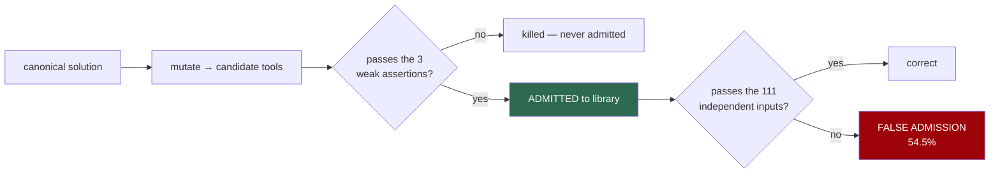

# When a Self-Verifying Agent Admits a Broken Tool

**A measurement of the false-admission rate in self-evolving tool libraries — and a negative result about the obvious fix.**

Agents that synthesize their own tools (Voyager, CREATOR, LATM, TroVE, CRAFT) all share one admission rule: *the same LLM writes both the code and the tests, and the tool joins the library if its own tests pass.* The oracle is self-consistent. "Verified" is unearned.

This repo measures what that costs, and tests whether the standard test-quality metric can fix it.

```
FAR = P( tool is wrong │ it passed its own tests and was admitted )

    = 54.5%   95% CI [47.9%, 60.9%]      (122 of 224 admitted tools)
```

More than half the tools admitted to the library are wrong.

---

## Results

| Hypothesis (pre-registered) | Verdict |
|---|---|
| **H1** — false admission is common (≥15%) | ✅ **SUPPORTED.** FAR = 54.5% [47.9%, 60.9%] |
| **H2** — mutation adequacy of the admitting suite predicts which tools are wrong | ❌ **REFUTED.** AUC 0.578 vs. 0.519 for a naive code-size baseline; Δ = +0.060 **[−0.042, +0.160]** |
| **H3** — gating on mutation adequacy halves FAR at usable coverage | ❌ **REFUTED.** Best case τ=0.7: FAR 48.9% at 60% coverage — a 10% reduction, not 50% |

**Two of the three hypotheses are dead, including the intervention.** The kill conditions were written down *before* the experiments ran ([`02-thesis-and-architecture.md` §3.3](audit/research-pivot/02-thesis-and-architecture.md)) and they are reported unedited.

### Why the fix fails

Mutation adequacy is **saturated**: median score **1.00**, p25 = 0.80. Half the tasks kill *every* mutant and still admit broken tools.

> A metric sitting at its ceiling for half the population cannot rank that population.

Mutation score measures sensitivity to *the faults the operators inject*. False admissions are driven by *the faults those operators under-represent* — off-by-one constants alone (`CRP`) account for **57 of the 122** false admissions. The metric and the failure mode are looking at different things.

This rules out the cheap fix. It does **not** rule out oracle hardening in general — property-based testing, metamorphic relations, and independently-authored adversarial suites remain untested, and are the natural next candidates precisely because they escape the operator-shaped fault space that defeats mutation score here.

---

## How it's measured

The trick is an oracle that is **independent of the LLM**, so "verified" can be checked against something that cannot be gamed.

[MBPP+](https://evalplus.github.io/) gives us exactly that. Each task ships:

- **`base_input`** — the **3** assertions from the original MBPP. This is the *weak* oracle standing in for a self-generated suite. (MBPP's prompt literally *embeds* these 3 assertions, so an LLM writing tests from the prompt reproduces a suite of about this strength.)
- **`plus_input`** — **~111** inputs (EvalPlus's 35× augmentation), authored independently of any LLM. This is **ground truth**.

A candidate that **passes the 3 and fails the 111** is a false admission: the library accepted a tool whose contract is wrong.

Candidates are mutants of the human canonical solution — real, subtly-wrong programs. To keep it non-circular, each task's mutants are split **disjointly**: an *adequacy set* (which scores the suite) and a held-out *candidate set* (the tools seeking admission). A train/test split, so H2's prediction is genuinely out-of-sample.

Nothing self-reports: every candidate is run **side by side with the canonical solution** on the same deep-copied inputs, and their outputs are compared.



---

## Run it

**Experiment A needs no API key.** It is CPU-only and takes ~20 minutes.

```bash
python -m venv .venv && .venv/bin/pip install -r requirements.txt

PYTHONPATH=. .venv/bin/python -m sea exp-a     # FAR + suite-level gate
PYTHONPATH=. .venv/bin/python -m sea exp-a2    # the per-tool gate (the faithful test)
PYTHONPATH=. .venv/bin/python -m pytest tests/ -q
```

Results land in `results/*.json`. Deterministic under `--seed`.

**Experiment B — the LLM arm — has never been run.** It is implemented and tested, but no API key was available. **No LLM-arm numbers appear anywhere in this repository, because none were produced.** With a key:

```bash
export OPENAI_API_KEY=sk-...
PYTHONPATH=. .venv/bin/python -m sea exp-b --limit 100
```

---

## What this is not

Honesty list, because a self-verifying system that oversells itself is the exact failure mode under study.

- ❌ **We did not discover the verification–conformance gap.** [EvolveTool-Bench](https://arxiv.org/abs/2604.00392) (Kaliyev & Maryanskyy) did, and reported 96.8% of 222 synthesized tools failing held-out conformance. Our delta is the **admission-conditioned** rate `P(wrong | admitted)`, which they do not report, plus a tested (and failed) intervention.
- ❌ **No novelty is claimed in mutation testing.** Using mutants to assess test quality is established ([VALTEST](https://arxiv.org/html/2411.08254v1), [mutation-guided test generation](https://arxiv.org/html/2506.02954v4)). Our contribution was to try it as an *admission gate for a tool library* — and report that it does not work.
- ❌ **No security guarantee.** Generated code runs in a subprocess with resource limits. That is a **safety** boundary (runaway loops, memory bombs), **not a security boundary** — a determined exploit escapes it, and on macOS `RLIMIT_AS` is not even enforced (measured, not assumed). Run the harness in a container if you do not trust the prompts.
- ❌ **No claim of self-improvement, learning, or auto-tuning.** Nothing here learns. The one threshold (`τ`) is swept and reported, never "discovered."
- ❌ **No SOTA claim.** We are not competing on pass@1.
- ❌ **Mutants are not LLM-written code.** Their fault distribution is operator-shaped, not model-shaped. Experiment A establishes the mechanism and validates the instrument; it does not substitute for the LLM arm. *(Convergent evidence: EvalPlus reports top models losing 19–29 points under the augmented tests — that is `P(fail strong | pass weak)` for real LLM code, consistent with H1. We cite it; we do not claim it.)*
- ❌ **54% of MBPP+ tasks were excluded** (canonical solutions too short to yield ≥6 mutants). The sample skews toward longer functions.
- ❌ **In the LLM arm, H2/H3 are UNTESTED, not refuted.**

---

## Architecture

~2,900 lines. The one rule is structural:

> ### 🔒 Generated tests are immutable.
> Once the model emits a suite, nothing may alter it. Repair rewrites the **implementation** only. `synthesis.py` pins the suite with a SHA-256 and asserts it never changes.
>
> This repo previously contained a method called `_apply_aggressive_test_fixes` that, when generated tests failed, **rewrote the failing assertions until they passed** — and registered the tool anyway as "experimental" if they still didn't. A pass rate produced that way measures nothing. *A synthesis failure rate is a result; a zero failure rate obtained by editing the oracle is a fabrication.*

```
sea/
├── sandbox.py     the ONLY way code executes (subprocess + rlimits)
├── mutation.py    7 AST operators (AOR ROR COR CRP RVR SDL UOI) + mutation score
├── synthesis.py   spec → tests 🔒 → impl → bounded repair (impl only)
├── agent.py       retrieve-or-synthesize → verify → gate → register
├── registry.py    SQLite + numpy cosine
└── eval/
    ├── oracle.py       MBPP+ differential testing — the independent oracle
    ├── stats.py        FAR, AUC (Mann-Whitney), Wilson + bootstrap CIs
    ├── experiment_a.py suite-level gate
    ├── per_tool.py     per-tool gate — the faithful test of the thesis
    └── experiment_b.py the LLM arm (needs a key; never run)
```

Full decision record, including everything deleted and why, in [`audit/research-pivot/`](audit/research-pivot/).

## Prior work

[Voyager](https://arxiv.org/abs/2305.16291) · [CREATOR](https://arxiv.org/abs/2305.14318) · [LATM](https://arxiv.org/abs/2305.17126) · [TroVE](https://arxiv.org/abs/2401.12869) · [Reflexion](https://arxiv.org/abs/2303.11366) · [EvalPlus](https://arxiv.org/abs/2305.01210) · [EvolveTool-Bench](https://arxiv.org/abs/2604.00392) · [Do LLMs generate test oracles that capture actual or expected behaviour?](https://arxiv.org/pdf/2410.21136)
