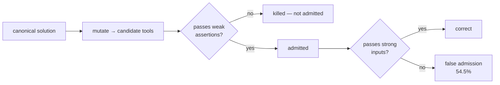

# False admission in self-verifying tool libraries

Systems like Voyager, CREATOR, LATM, TroVE, and CRAFT grow a tool library by synthesizing code and tests from the same model, then admitting a tool when those tests pass. That check can pass even when both the code and the tests are wrong about the task.

This repo measures how often that happens on [MBPP+](https://evalplus.github.io/), treating EvalPlus’s held-out inputs as ground truth. It also checks whether the mutation score of the admitting suite can filter bad admissions. It cannot.

**Main result.** 122 of 224 admitted tools fail the strong suite — **FAR = 54.5%** (95% CI 47.9–60.9%).

---

## Findings

| Hypothesis | Verdict |
|---|---|
| **H1** — FAR ≥ 15% | Supported (54.5% [47.9%, 60.9%]) |
| **H2** — mutation adequacy predicts which admitted tools are wrong | Not supported (AUC 0.578 vs 0.519 code-size baseline; Δ +0.060 [−0.042, +0.160]) |
| **H3** — gating on mutation adequacy halves FAR without collapsing coverage | Not supported (best τ=0.7: FAR 48.9% at 60% coverage, ~10% relative drop) |

Mutation score measures how tightly the suite pins down *this* implementation. False admission is different: the suite and the implementation were written together from the same wrong reading of the task, so they agree. A high mutation score can still mean “wrong, but consistent.”

```
mean adequacy | correct tools : 0.736  (n=102)
mean adequacy | wrong tools   : 0.696  (n=122)

suites that kill 100% of mutants of their own impl : 8
of those, still wrong                              : 3 (38%)
```

Coverage-style metrics have the same blind spot when they only look at suite vs code. A useful gate needs something outside that pair (independent tests, metamorphic checks, a second model, etc.). Not tested here.

---

## Method

[MBPP+](https://evalplus.github.io/) supplies an oracle independent of any model:

- **Weak oracle** — `base_input`: the original MBPP assertions (typically 3). Proxy for a self-generated admission suite (MBPP prompts embed these assertions).
- **Strong oracle** — `base_input` + `plus_input`: ~111 inputs from EvalPlus’s 35× augmentation, authored independently of any LLM. Ground truth.

**False admission** := passes the weak oracle and fails the strong one.

Candidates are mutants of the human canonical solution. Each candidate runs side by side with the canonical solution on deep-copied inputs; outputs are compared. Per task, mutants are split disjointly into an *adequacy set* (scores the suite) and a held-out *candidate set* (tools seeking admission), so H2 is out-of-sample.

Only 15.7% of mutants survive the weak oracle; of those admitted, 54.5% fail the strong oracle. Tasks whose canonical solution cannot yield ≥6 mutants for a disjoint split are excluded (204 of 378; 174 used). Results: `results/experiment_a.json`, `results/experiment_a2_per_tool.json`.



**Experiment A** (`exp-a`) estimates FAR and a suite-level gate. **Experiment A2** (`exp-a2`) is the faithful per-tool gate (mutate each admitted tool’s own implementation and score its own suite) — the primary test of H2/H3.

Generated tests are immutable: repair may rewrite the implementation only (`synthesis.py` pins the suite with SHA-256).

---

## How to run

Experiment A / A2 need no API key (~20–25 minutes, CPU only):

```bash
python -m venv .venv && .venv/bin/pip install -r requirements.txt

PYTHONPATH=. .venv/bin/python -m sea exp-a     # FAR + suite-level gate
PYTHONPATH=. .venv/bin/python -m sea exp-a2    # per-tool gate (primary H2/H3 test)
PYTHONPATH=. .venv/bin/python -m pytest tests/ -q
```

Outputs go to `results/*.json`. Deterministic under `--seed`.

**Experiment B (LLM arm)** is implemented and unit-tested but has not been run (no API key in this environment). No LLM-arm numbers are reported. To run:

```bash
export OPENAI_API_KEY=...
PYTHONPATH=. .venv/bin/python -m sea exp-b --limit 100
```

---

## Repository layout

```
sea/
├── sandbox.py      subprocess execution + resource limits
├── mutation.py     AST operators + mutation score
├── synthesis.py    spec → immutable tests → impl → bounded repair
├── agent.py        retrieve / synthesize / verify / gate / register
├── registry.py     SQLite + cosine retrieval
└── eval/
    ├── oracle.py         MBPP+ differential testing
    ├── stats.py          FAR, AUC, Wilson + bootstrap CIs
    ├── experiment_a.py   suite-level study
    ├── per_tool.py       per-tool gate
    └── experiment_b.py   LLM arm (not run)
results/            committed JSON from exp-a / exp-a2
tests/              unit tests for the harness
```

---

## Limitations

- **Mutants are not LLM-written code.** Faults are operator-shaped. Experiment A validates the instrument and the mechanism; it does not replace the LLM arm. EvalPlus reports top models losing 19–29 points under augmented tests (`P(fail strong | pass weak)` on real model code) — cited as convergent evidence for H1, not claimed as a result of this repo.
- **Experiment B was not run.** In the LLM arm, H2/H3 are untested, not refuted.
- **Sample restriction.** 54% of MBPP+ tasks were excluded (canonical solutions too short for ≥6 mutants). The retained sample skews toward longer functions; FAR on excluded short tasks is likely lower.
- **Single benchmark / language / operator set.** Exact FAR depends on the mutant generators; direction and magnitude are the robust claim.
- **No security claim.** Subprocess + rlimits are a safety boundary. On macOS, `RLIMIT_AS` is not enforced. Run untrusted prompts in a container.
- **No claim** of discovering the verification–conformance gap, of novelty in mutation testing itself, of self-improvement / auto-tuning, or of SOTA pass@1.

---

## Prior work

[Voyager](https://arxiv.org/abs/2305.16291) · [CREATOR](https://arxiv.org/abs/2305.14318) · [LATM](https://arxiv.org/abs/2305.17126) · [TroVE](https://arxiv.org/abs/2401.12869) · [Reflexion](https://arxiv.org/abs/2303.11366) · [EvalPlus](https://arxiv.org/abs/2305.01210) · [EvolveTool-Bench](https://arxiv.org/abs/2604.00392) · [VALTEST](https://arxiv.org/html/2411.08254v1) · [Do LLMs generate test oracles that capture actual or expected behaviour?](https://arxiv.org/pdf/2410.21136)

EvolveTool-Bench reports that 96.8% of 222 synthesized tools fail held-out conformance. This work reports the admission-conditioned rate `P(wrong | admitted)` and a negative result for mutation-adequacy gating.
