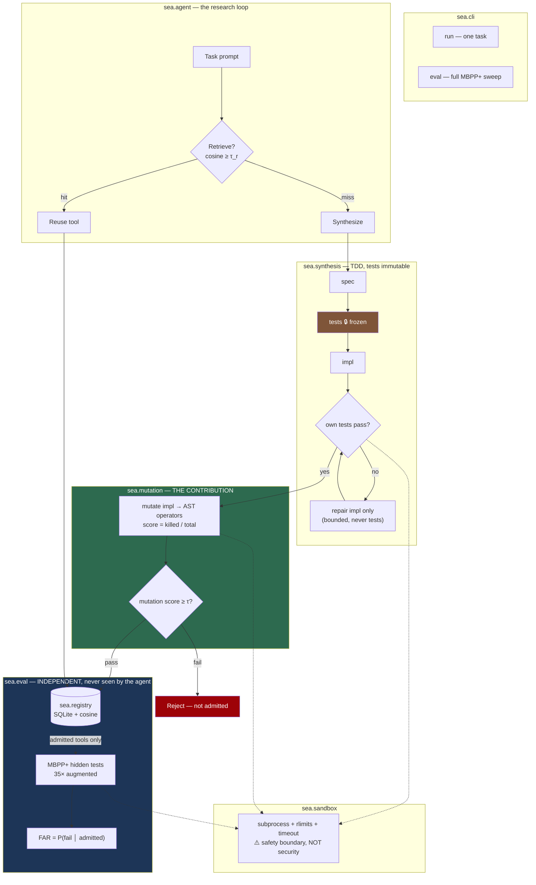

# Phase 2 — Thesis Lock, Scope Cut, and Architecture

**Status:** LOCKED. Phases 3 and 4 execute this document and may not renegotiate it without appending an ADR here.
**Inputs:** `01-track-1-landscape-and-gap.md`, `01-track-2-codebase-autopsy.md`
**Date:** 2026-07-13

---

## 1. Scope

Phase 1 produced two artefacts. Track 1 mapped the literature and concluded that every headline claim of this repo is already-done prior art. Track 2 dissected the code and concluded that the repo's central claim — TDD-verified tool synthesis — is falsified by its own source, and that untrusted generated code executes on the host.

This document does three things: it locks **one** research thesis, locks **one** application domain, and records a 3-option decision for every load-bearing dependency. It ends with an explicit, aggressive delete-list.

---

## 2. Grounding notes (sources I fetched personally in Phase 2)

I re-verified Track 1's load-bearing citations myself, because the entire novelty argument depends on them and a fabricated competitor would destroy the deliverable.

| Source | Verified? | What it actually says | Consequence for us |
|---|---|---|---|
| [arXiv:2604.00392](https://arxiv.org/abs/2604.00392) — *Beyond Task Completion: A Verification-vs.-Conformance Gap in Tool-Evolving Agents* (Kaliyev & Maryanskyy), a.k.a. **EvolveTool-Bench** | ✅ **REAL — fetched abstract** | 222 synthesized tools on Claude Haiku 4.5; **96.8% record per-tool correctness C=0.00 despite passing in-session verification.** Defines a Tool Quality Score + six library metrics (reuse rate, redundancy, composition success, regression stability, creation efficiency, safety). "Hidden tests catch defects self-generated tests miss." | **Kills "we discovered the gap" as a claim.** The observation is taken. Our novelty must live in the *predictor* and the *intervention*. We cite this in paragraph one. |
| [arXiv:2410.21136](https://arxiv.org/pdf/2410.21136) — *Do LLMs generate test oracles that capture the actual or the expected program behaviour?* (Konstantinou, Degiovanni, Papadakis) | ✅ **REAL** | Generating tests from the code under test creates a "circularity of error": bugs in the implementation are reflected into the tests. Tests capture **what the code currently does, not what it should do**. | This is the *mechanism* behind the gap. We cite it as the causal story. |
| [EvalPlus](https://evalplus.github.io/) — HumanEval+ / MBPP+ | ✅ **REAL** | HumanEval+ = **80×** more tests; MBPP+ = **35×** more tests. Built because original benchmarks "cannot detect subtle bugs." Under the tougher tests top models lose **19–29 points** of apparent pass rate. | **This is our independent oracle.** Note the correction: Track 1 wrote "80× for both" — MBPP+ is **35×**, not 80×. Corrected here. |
| [arXiv:2506.02954](https://arxiv.org/html/2506.02954v4) — *Mutation-Guided Unit Test Generation with an LLM*; [VALTEST arXiv:2411.08254](https://arxiv.org/html/2411.08254v1) | ✅ **REAL** | Mutation score = killed mutants / total mutants; used as a **test-adequacy** metric. VALTEST replaces invalid LLM tests to raise mutation score. | **Constrains our claim.** Mutation testing to *improve test suites* is done. We must not claim that. Our delta is the *setting* and the *decision* — see §3.4. |

**Correction issued to Track 1's artefact:** MBPP+ is 35× augmented, not 80×. HumanEval+ is 80×. Phase 4 must not report the wrong figure.

---

## 3. The locked thesis

### 3.1 Setting

A self-engineering agent receives a task and either **retrieves** a capability from its library or **synthesizes** a new one. Synthesis is TDD-shaped: the *same LLM*, from the *same prompt*, writes both the tests and the implementation. The tool is admitted to the library **iff it passes its own tests**.

This is precisely the Voyager / CREATOR / LATM / TroVE / CRAFT pattern, and it is exactly what this repo implements today.

### 3.2 The problem

The admission oracle is **self-consistent**. The tests were authored by the same model, from the same prompt, as the code they judge. Per Konstantinou et al., such tests encode *what the code does*, not *what the task requires*. Therefore the word "verified" is unearned — and every downstream claim built on it (a growing library of *trustworthy* capabilities) inherits the defect.

EvolveTool-Bench confirmed the consequence empirically. But it is a **diagnostic benchmark**: it reports that the gap exists. It does not say *what predicts* an individual tool's failure, and it does not offer an *intervention* that closes it.

### 3.3 The claim (falsifiable, with kill conditions)

Define the **False Admission Rate**:

> **FAR = P( tool fails an independent held-out oracle │ tool passed its self-generated suite AND was admitted to the library )**

This conditional — admission-conditioned failure — is the quantity nobody reports.

| # | Hypothesis | Kill condition |
|---|---|---|
| **H1** *(magnitude)* | On MBPP+ with a current frontier model, **FAR ≥ 15%**. Tools enter the library carrying a materially wrong contract. | FAR < 5% → the problem does not exist at this model tier. **H1 dead.** |
| **H2** *(predictor)* | FAR is predicted by the **mutation adequacy** of the admitting suite — the fraction of mutants of the tool's *own* implementation that its *own* tests kill. Mutation score achieves strictly higher AUC for predicting held-out failure than test count, test pass-rate, or suite length (bootstrap CI on the AUC difference excludes 0). | Mutation-score AUC ≈ test-count AUC → adequacy is not the mechanism. **H2 dead.** |
| **H3** *(intervention)* | An admission gate requiring mutation score ≥ τ **reduces FAR by ≥50%** vs. the ungated baseline, at **< 3× synthesis cost**, without collapsing library coverage (admission rate stays ≥ 50% of baseline). | Gate fails to halve FAR, **or** it rejects so much that coverage collapses. **H3 dead.** |

All three can fail. That is the point — a thesis that cannot lose is not a thesis.

### 3.4 Delta vs. prior work (stated precisely, no renaming)

| Prior work | What they did | What we do that they did not |
|---|---|---|
| **EvolveTool-Bench** (2604.00392) | *Observes* the verification–conformance gap; diagnostic metrics over a tool library. | We report the **admission-conditioned** FAR (they do not), supply a **per-tool predictor** of it, and supply an **intervention** that reduces it. Observation → mechanism → control. |
| **Mutation-guided test gen** (2506.02954), **VALTEST** (2411.08254) | Use mutants to *improve a test suite* for a **fixed, human-written codebase under test**. | We use mutation adequacy as an **admission gate for a persistent, retrievable tool library**, where **both code and tests are LLM-generated from the same prompt**, and the decision is whether an artefact is durable enough to be *reused on unseen future tasks*. Different setting, different decision, different cost model. |
| **Voyager, CREATOR, LATM, TroVE, CRAFT** | Synthesize → verify (self-consistent or instance-local oracle) → register → retrieve. | We do not propose a new synthesis loop. We **measure what their admission criterion costs** and harden it. |
| **Konstantinou et al.** (2410.21136) | Show LLM oracles capture actual, not expected, behaviour — on standalone test generation. | We show this failure **propagates into and persists inside a skill library**, and that its severity is *measurable and controllable* at admission time. |

**In one sentence:** *Prior work observes that self-verified tool libraries are unreliable; we show the unreliability is predictable from the mutation adequacy of the admitting suite, and that gating on it halves the false-admission rate.*

### 3.5 What we will NOT claim

- ❌ We do **not** claim to have discovered the verification–conformance gap. **EvolveTool-Bench did.** We cite it up front.
- ❌ We do **not** claim novelty in mutation testing, or in using mutation score to assess test quality. That is established.
- ❌ We do **not** claim general self-improvement, open-endedness, or that the agent gets smarter over time.
- ❌ We do **not** claim **any** security property. Generated code runs in a subprocess with resource limits — a *safety* boundary, **not** a security boundary. See D2.
- ❌ We do **not** claim SOTA on any benchmark. We are not competing on pass@1.
- ❌ We do **not** claim cross-provider generality. Single provider, 1–2 models. (This is EvolveTool-Bench's stated weakness too; we inherit it and say so.)
- ❌ We do **not** claim to have *measured organic library reuse*. MBPP+ tasks are largely independent, so the reuse signal is weak. The amortization argument in H3 is **modeled analytically, not observed.** We will report the observed reuse rate honestly, however low it turns out to be.
- ❌ We do **not** claim mutation score is the *only* or *optimal* adequacy signal — only that it beats the naive alternatives we test.

---

## 4. The locked domain: **MBPP+ (EvalPlus)**

Selection was by criteria, decided **before** looking at candidates.

**Criteria:**
1. **C1 — Oracle independence (non-negotiable).** Ground truth must come from a source *independent of the synthesizing LLM*. Without this, FAR is untestable and the whole thesis collapses.
2. **C2 — Function-shaped tasks.** A "tool" must be a well-defined unit, so admission/retrieval/reuse are meaningful.
3. **C3 — CPU-only, no network, no GPU.** Must run overnight on a laptop.
4. **C4 — Public and reproducible.** A reviewer must be able to re-run it.
5. **C5 — Statistical power.** Enough tasks to compute FAR with a usable CI.

| Candidate | C1 Oracle indep. | C2 | C3 | C4 | C5 | Verdict |
|---|---|---|---|---|---|---|
| **MBPP+ (EvalPlus)** | ✅ Human canonical solution + **35×** augmented inputs, authored independently of our agent | ✅ one function per task | ✅ | ✅ pip `evalplus` / HF | ✅ **378 tasks** | ✅ **SELECTED** |
| HumanEval+ | ✅ (80×) | ✅ | ✅ | ✅ | ⚠️ only 164 tasks | Secondary / replication set |
| GSM8K | ❌ **instance-level ground truth only** — a single answer per problem, which is *exactly the flaw we are attacking* | ❌ not function-shaped | ✅ | ✅ | ✅ | ❌ **REJECTED on C1** |
| SWE-bench | ✅ | ❌ repo-level, not function-level | ❌ heavy | ✅ | ⚠️ | ❌ **REJECTED on C2/C3** |
| Minecraft (Voyager) | ❌ no programmatic oracle | ❌ | ❌ needs game env | ⚠️ | ⚠️ | ❌ **REJECTED on C1/C3** |
| **Current e-commerce CSV demo** | ❌ **no oracle whatsoever** | ⚠️ | ✅ | ❌ | ❌ (3 tools) | ❌ **REJECTED — this is why the repo can currently make no verification claim at all** |

**Locked: MBPP+ primary, HumanEval+ as a replication set if time permits.**

**The critical protocol constraint:** the agent **never sees** the MBPP+ tests. It writes its own tests from the natural-language prompt alone. Admission is decided on its own tests. *Only then* do we score the admitted tool against MBPP+'s hidden oracle. That separation is what makes FAR a real number and not a self-report.

---

## 5. Architecture decisions (3-option protocol)

### D1 — Storage

| | Option | Tradeoff |
|---|---|---|
| A | Supabase / pgvector | Network dependency in the eval path; reviewer must provision a cloud project to reproduce. **And the committed migration is non-functional**: `embedding BYTEA` (no pgvector), zero indexes, and **zero SQL functions** while Python calls six RPCs (Track 2). Retrieval provably cannot work as committed. |
| B | **SQLite + numpy cosine** | Hermetic, offline, zero setup. Brute-force cosine over a few hundred 1536-d vectors is microseconds — an ANN index is pointless below ~10⁵ vectors. |
| C | Filesystem + FAISS | Extra dependency, no transactional integrity, overkill at this scale. |

**→ PICK B.** Reproducibility is a *research requirement*, not a preference. This removes a network dependency from the measurement path and deletes a subsystem that never worked.

### D2 — Sandbox (the honest one)

Mutation testing is execution-hungry: ~30 mutants × ~6 tests × ~400 tools ≈ **10⁵ executions**.

| | Option | Tradeoff |
|---|---|---|
| A | Docker per execution | Real isolation. ~1–2 s container startup × 10⁵ ≈ **days**. Infeasible. |
| B | **subprocess + `RLIMIT_AS`/`RLIMIT_CPU` + wall-clock timeout + no network + scratch cwd** | ~10 ms startup → 10⁵ executions is tractable. **Not** a security boundary against adversarial code. **Is** a real boundary against the actual threat: accidental infinite loops, memory bombs, stray writes. |
| C | Status quo — `importlib.exec_module` **on the host** | What the repo does today (`executor.py:70-82`). Unacceptable and dishonest. |

**→ PICK B, and ship a Dockerfile that wraps the *entire harness*.**

**Honest statement, to appear in the README and the paper:** *Our threat model is accidental damage from code generated off benign benchmark prompts — not a malicious adversary. Per-execution isolation is a **safety** boundary, not a **security** boundary; a determined exploit escapes it. Anyone running this against untrusted prompts should run the whole harness inside the provided container.* We explicitly retract the README's "5-layer defense-in-depth" claim, which Track 2 graded 2 real / 1 half / 2 fictional.

### D3 — Interface

| | Option | Tradeoff |
|---|---|---|
| A | Flask + SocketIO web UI (523 LOC) | Zero research value. Ships `cors_allowed_origins="*"` + a hardcoded `SECRET_KEY` **on a service that executes generated code on the host**. |
| B | **CLI only** (`python -m sea …`) | Scriptable, reproducible; what a researcher actually runs. |
| C | Notebook | Fine for figures, wrong as the primary interface. |

**→ PICK B.** Delete the web UI entirely.

### D4 — Learning loop

| | Option | Tradeoff |
|---|---|---|
| A | Keep auto-tuner + pattern miner + composite promoter + skill graph + reflection (~2,500 LOC) | All fake or dead. The "tuner" scores candidates by distance to a hardcoded `0.45` and writes it back as a learned optimum. |
| B | **Single synthesis → gate → register → reuse loop** | Exactly what the thesis needs. Nothing more. |
| C | B + a bounded *repair* loop | A repair loop (fix the **implementation** when its own tests fail) is legitimate — it is part of the baseline TDD protocol we are measuring. |

**→ PICK C** (B plus bounded repair), with one **non-negotiable rule**:

> ### 🔒 TESTS ARE IMMUTABLE.
> Once the LLM generates a test suite, **nothing may modify it** — not a regex, not a retry, not a "fix." Repair may only touch the **implementation**. A synthesis failure rate is a *result*; a zero failure rate achieved by editing the tests is a *fabrication*. The current `_apply_aggressive_test_fixes` is deleted, not refactored.

### D5 — LLM provider

Keep OpenAI (existing dependency and key), behind a thin client, with the model **configurable** (the `gpt-4` default is obsolete). **All LLM responses are cached to disk, content-addressed by prompt hash.** This is not an optimization — it is what makes the experiment *replayable by a reviewer without burning API credit*, and deterministic on re-run.

---

## 6. Target architecture (one page)



**The dashed line from the registry to MBPP+ is the entire experiment.** The agent decides admission on the left. The oracle scores it on the right. The two never touch until after admission.

### Package layout

```
sea/
├── __init__.py
├── config.py        # fail-fast: raises on missing OPENAI_API_KEY at import
├── llm.py           # thin OpenAI client + content-addressed disk cache
├── synthesis.py     # spec → tests(frozen) → impl → bounded repair
├── sandbox.py       # subprocess + rlimits; the ONLY way code executes
├── mutation.py      # AST mutation operators + mutation score   ← contribution
├── registry.py      # SQLite + numpy cosine retrieval
├── agent.py         # retrieve-or-synthesize → verify → gate → register
├── cli.py
└── eval/
    ├── mbpp_plus.py # loads EvalPlus; the independent oracle
    ├── far.py       # FAR, AUC, bootstrap CIs
    └── run.py
tests/               # real pytest suite over the above
```

---

## 7. Delete-list (aggressive, explicit)

Deleted outright. ~8,000 LOC.

| Path | LOC | Why |
|---|---|---|
| `src/auto_tuner.py` | 427 | **Fake learning.** Scores candidates by distance to a hardcoded `optimal = 0.45`, then writes 0.45 back as a discovered optimum. |
| `src/skill_graph.py` | 537 | Dead. **Zero callers.** |
| `src/composite_synthesizer.py` | 500 | Out of thesis scope. |
| `src/reflection_engine.py` | 483 | `apply_fix()` never called at runtime. Replaced by bounded impl-only repair in `synthesis.py`. |
| `src/query_planner.py` | 421 | Keyword-matching theater. |
| `src/composition_planner.py` | 395 | Out of scope. |
| `src/policy_store.py` | 382 | 4 of 6 policies never read. Serves the deleted tuner. |
| `src/session_memory.py` | 171 | Conversational memory — irrelevant to a batch experiment. |
| `src/response_synthesizer.py` | 84 | Chat formatting. |
| `src/workflow_tracker.py` | 445 | Pattern mining into a swallowed exception. |
| `src/orchestrator.py` | 837 | Rewritten as `sea/agent.py` (~150 LOC). |
| `src/executor.py` | 181 | **Executes generated code on the host.** Rewritten as `sea/sandbox.py`. |
| `src/synthesis_engine.py` | 448 | Rewritten — `_apply_aggressive_test_fixes` **deleted, not refactored**. |
| `src/capability_registry.py` | 404 | Rewritten as SQLite `sea/registry.py`. |
| `src/migrations/tables.sql` | — | Non-functional migration (no pgvector, no RPCs). |
| `web/` (app, static, templates) | 523+ | D3. |
| `scripts/batch_pattern_miner.py` | 168 | Stub miner. |
| `evaluation/` (all, incl. `tests/`) | ~2,823 | **Test theater — zero `assert` statements.** The "learning" test uses `>=` so it passes when nothing is learned. Replaced by `sea/eval/` + real `tests/`. |
| `docs/api/` | ~5,700 | Documents a Flask API that is being deleted. |
| `tools/`, `data/` | — | E-commerce demo coupling. |
| `docker/sandbox.dockerfile` | — | Replaced by a harness-level Dockerfile (runs as **non-root** — the current one has no `USER`). |

**Dependencies:** drop `supabase`, `flask`, `flask-socketio`, `flask-restx`, `eventlet`, `docker`. Add the genuinely-imported-but-missing `numpy`, plus `evalplus`. Track 2 found `requirements.txt` omits `pandas`, `numpy`, `matplotlib`, `seaborn`, `psutil` while the code imports them — the file will be regenerated to match reality.

---

## 8. Residual risk

| Risk | Mitigation |
|---|---|
| **FAR comes back tiny (< 5%) → H1 dies.** Frontier models may be good enough on MBPP that self-consistent tests rarely admit a wrong tool. | This is a *legitimate negative result* and we report it as one. It would still be the first *conditional* FAR number published. We also keep HumanEval+ (harder) as a replication set, and can down-tier the model to widen the effect — reporting model tier honestly. |
| **Equivalent mutants** inflate the denominator and depress mutation score. | Standard problem, standard mitigations: skip no-op mutants; count timeouts as killed; report the operator set explicitly. We do **not** claim to solve equivalent-mutant detection. |
| **MBPP+ contamination** — the model may have memorized MBPP. | Acknowledge explicitly. Contamination inflates *pass rate*, which if anything **biases FAR downward** — making H1 a *conservative* estimate. Note as a limitation. |
| Mutation testing is slow. | Cap mutants per tool (~30), parallelize, cache. Budget-check early in Phase 3. |
| **Reuse amortization is modeled, not measured.** | Already in non-claims (§3.5). Report observed reuse rate honestly even if ~0. |

---

## 9. ADRs (irreversible choices)

- **ADR-001 — Supabase removed.** Vector store replaced by SQLite. Irreversible without re-adding a network dependency. Justified: the committed migration cannot execute, and reproducibility outranks scale we do not have.
- **ADR-002 — Per-execution isolation is a safety, not security, boundary.** Justified in D2. Must be stated in the README, not buried. Any future claim of security requires re-doing D2 with option A.
- **ADR-003 — Generated tests are immutable.** The single rule that makes any number in Phase 4 trustworthy. Violating it invalidates the entire result.

---

## 10. AMENDMENT — ADR-004: the intervention thesis did not survive contact with the data

*Appended 2026-07-13, after Phase 4. The sections above are left exactly as they were written **before** the experiments ran. That is the point of pre-registration: the kill conditions in §3.3 are only worth something if they are not quietly edited once they fire.*

**They fired.**

| Hypothesis | Pre-registered kill condition | Result |
|---|---|---|
| **H1** — FAR ≥ 15% | dead if FAR < 5% | ✅ **SUPPORTED.** FAR = **54.5%** [47.9%, 60.9%] |
| **H2** — mutation adequacy predicts false admission, beating naive baselines | dead if its AUC ≈ the baseline's | ❌ **DEAD.** AUC 0.578 vs. 0.519; Δ = +0.060 **[−0.042, +0.160]**, CI includes 0 |
| **H3** — a mutation gate halves FAR at ≥50% coverage | dead if it fails to halve FAR, or coverage collapses | ❌ **DEAD.** Best is τ=0.7 → FAR 48.9% at 60% coverage: a 10% reduction, not 50% |

**Mechanism (not an excuse — a finding).**

> **Mutation adequacy measures suite↔implementation coupling. False admission is a failure of suite↔specification coupling.**

Mutation score asks *"if I perturb this implementation, does the suite notice?"* — it is computed **against the implementation**. But a falsely-admitted tool is not wrong because its code drifted from its tests. It is wrong because **the code and the tests were co-generated from the same misunderstanding**, and they agree with each other perfectly. Tightly pinning down a wrong behaviour earns a *high* mutation score: the metric rewards the very pathology it was recruited to detect.

The decisive number: **of the 8 tools whose own suite kills 100% of the mutants of their own implementation, 3 (38%) are still wrong.** Mean adequacy separates correct from wrong tools by just **+0.040** (0.736 vs 0.696).

*(A note on intellectual honesty: my first explanation was that the metric "saturates". That is true of the suite-level score — median 1.00 — and **false** of the per-tool score, where only 3.6% sit at the ceiling. The tidy story did not survive contact with the per-tool distribution. The mechanism above is what the data actually supports. See `04-eval-and-iteration.md` §4.)*

**The generalisation, which is bigger than my hypothesis.** *Any* adequacy metric computed against the implementation is structurally incapable of detecting false admission — mutation score, branch coverage, line coverage. They all audit the suite against the code, and the code is the thing that is wrong. A working gate must import information from **outside** the co-generated pair.

**Consequent restatement of the contribution.** The thesis in §3.3 was *"the gap is predictable and gateable."* Half of that is false. What survives is:

1. **The first admission-conditioned FAR** — `P(wrong | admitted)` = 54.5%. EvolveTool-Bench reported *unconditional* per-tool correctness; this is the conditional a library owner actually experiences, and nobody had reported it.
2. **A mechanistic negative result that rules out the obvious fix.** Mutation adequacy is *the* metric the literature reaches for (VALTEST, mutation-guided test generation) and it is the one I reached for. It does not transfer to the admission decision. Knowing the cheap fix fails — and why — is worth more than not knowing.
3. **A reproducible, LLM-free, CPU-only harness** a reviewer can run in ~20 minutes with no API key.

**What this does NOT license us to claim.** Oracle hardening in general is *not* refuted — only mutation-adequacy gating, and only in the LLM-free proxy. Property-based testing, metamorphic relations, and independently-authored adversarial suites are untested and remain the natural next candidates, precisely because they are not confined to the operator-shaped fault space that defeats mutation score here. In the LLM arm, H2/H3 are **UNTESTED, not refuted** — no API key was available, and no LLM-arm number is reported anywhere in this repository.

The architecture decisions (D1–D5) and the delete-list are unaffected: they were correct for reasons independent of whether the gate worked, and the gate's failure is *observable* precisely because the harness was built honestly.
